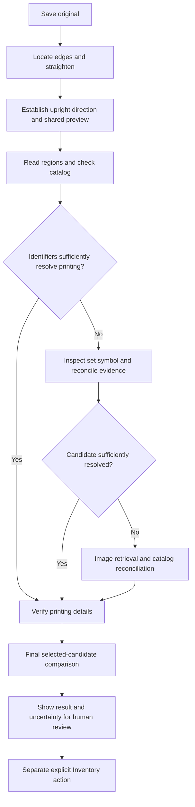

# Recognition pipeline design

Status: ordinary-card implementation authorized by Brian on November 20, 2026 and in progress in PR #1055; verification and individual merge approval remain pending. Related to [recognition tracker #307](https://github.com/sefaction/MTG-Archives/issues/307).

## November 20 implementation and profile decisions

Brian subsequently requested: "set up the new card recognition, and then open up an issue for setting up the token and art card scan." This authorizes the ordinary-card pipeline implementation and supersedes the earlier planning-only hold for that scope. [Issue #1056](https://github.com/sefaction/MTG-Archives/issues/1056) owns separate two-sided Token and Art card scan profiles; those are not part of this implementation. Merge, production rollout and physical scanner actions retain their separate approval requirements.

Token profiles must preserve two linked identified faces of one physical copy. Normalize A/B and B/A using stable face identities, display names alphabetically, distinguish different printings/artwork and face combinations, and allow search by either face without double counting. Art profiles use both sides to identify one art-card printing and stamp variant; the artwork is the primary view and reverse original-image retention follows ordinary recovery/retention rules rather than requiring a permanent reverse attachment. Pairing uncertainty, dropped/retried sides and reverse-image retention are tracked in #1056.

The original agreed workflow and tool choices below remain the design baseline. Implementation adds a bounded full-index fallback when provisional identifier verification fails; this is not automatic confirmation. Adaptive reading/inferred geometry also withhold new automatic-acceptance authority in legacy text-only configurations. Actual accuracy, performance and source/runtime qualification must be recorded before readiness claims.

Recognition should establish one upright, complete card crop, use readable identifiers for an efficient first determination, and invoke full image search when identification remains unresolved. Every route must reach printing verification and a final candidate comparison before human confirmation. The scan shown during review must use the same framing as recognition.

Brian approved recording this plan after reviewing the ordered process and tools. He also requested provisions for additional foundational frameworks, which he has not yet described. This document preserves the agreed direction without treating those provisions, implementation details or recognition thresholds as settled. The initial request authorized documentation only; the dated amendment above records the later ordinary-card implementation authority.

## Current baseline and proposed changes

Reviewed source baseline: `c7872a24dc1af1b17f9f05f61543b6e5be035e7a` (PR #1054). Production activation and targeted Portal evidence are recorded separately in Foundry and the work checkpoint; neither source availability nor that activation establishes broad recognition accuracy.

The existing preparation stage creates an EXIF-oriented preview. OCR and visual workers independently perform geometry and rotation attempts; enabled catalog reconciliation waits for visual evidence, and printing comparison follows the catalog. They do not yet consume the shared established upright crop proposed here. Current OCR includes fixed title/footer strips and a supplemental original-resolution footer reading.

The new work is shared geometry/orientation and its review preview, adaptive reading regions, additional field/symbol recognition, identifier-first routing, and a final comparison decision that is qualified on real scans. Existing image, OCR, catalog and printing tools provide building blocks; they do not make this proposed workflow already implemented.

## Proposed order of operations

### 1. Save the original scan

Use the existing upload storage and PostgreSQL records to preserve original bytes, identity and processing history. Derived images must not overwrite the original. Retrying or correcting recognition must remain possible without rescanning when the original is retained.

### 2. Locate the complete card and straighten it

Use OpenCV edge/contour detection, corner fitting and perspective correction. Combine outer boundaries, rounded corners and card proportions with internal artwork/text-box geometry when the outer boundary is unclear.

Border detection must accommodate black, white, silver and gold borders rather than rely on dark borders. Internal shapes can propose outer geometry, but must not cause artwork or a text box to be mistaken for the entire card. Preserve the full border, rounded corners and footer; retain a small protective margin when appropriate.

Record directly observed versus inferred boundaries and geometry uncertainty. An unsupported crop must remain uncertain and allow correction or a bounded fallback. Layout assumptions must accommodate exceptions such as full-art and unusual frames rather than force a standard rectangle of internal features onto every card.

### 3. Establish upright rotation and the shared preview

Use OpenCV rotation and a short PaddleOCR direction check based on title/footer placement and readable text. Geometry can establish portrait framing without proving which end is the top; crop and orientation therefore form one preparation phase, with limited reading allowed before the main OCR stage.

Persist one agreed geometry transform and reading direction, bound to the original image. Later stages must share that framing and coordinate mapping. Generate the browser preview with Sharp from that same preparation result. Detailed reading must retain access to original-resolution pixels; the browser thumbnail must not become the source for tiny footer text.

When direction is unresolved, preserve competing evidence rather than rotate confidently on one high OCR score. Crop/orientation corrections must invalidate affected downstream evidence without changing a saved human decision.

### 4. Read identifying regions and check the catalog

Use PaddleOCR, OpenCV region/layout detection and the existing TypeScript text parsers. Read the card name and footer identifiers first: set code, collector number, printed language marker and artist where available. Use the type line and mana cost as supporting evidence, particularly for ambiguous primary readings.

Mana symbols require symbol recognition, not ordinary text OCR alone. Proposed tools are OpenCV template matching with templates derived from the bundled `mana-font` assets, plus OCR for numbers. The assets already exist in the project; a qualified mana recognition implementation does not.

Check observations against the existing Card catalog, using the existing cached Scryfall metadata fallback where needed. Missing printed identifiers on older cards are valid missing evidence. Do not fabricate set/collector data or assume a language when it cannot be established.

#### 4a. Provisional identification fast path

If readable name, set code and collector number consistently identify one catalog printing, select it provisionally and continue to step 7. Evidence must agree spatially and semantically; an OCR score by itself is insufficient, and conflicting readable evidence prevents the shortcut. Exact gating thresholds and coverage must be measured before adoption.

The shortcut skips unnecessary full-index image retrieval, not printing verification, final visual comparison or human confirmation. Its candidate comparisons may still use reference images.

### 5. Identify the expansion symbol when still needed

Use OpenCV and the existing bundled Keyrune symbol templates to compare the observed symbol shape and narrow catalog candidates. Moving symbol evidence earlier than the current printing-stage use requires integration work and qualification.

Shared glyphs can represent multiple sets. An unreadable or missing symbol is not proof of a specific set or of symbol absence. If combined text/catalog/symbol evidence sufficiently resolves the candidate, continue to step 7; otherwise proceed to image retrieval. Symbol visibility and contradictory evidence remain relevant during final verification even for a fast-path candidate.

### 6. Retrieve image candidates when unresolved

Use the existing DINOv2 encoder through PyTorch on the CPU, NumPy reference-vector search, and OpenCV SIFT/RANSAC geometric matching. Search the installed versioned reference index, rerank the shortlist using geometric agreement, and reconcile the candidates with readable text, symbol and catalog evidence.

All matching uses the established card framing. Unsupported geometry must take an explicit uncertain fallback path, not silently become a verified crop. Missing reference coverage, unavailable catalog information and a poor image match must remain distinguishable.

The current deployed index has 114,364 available references; this is an installation snapshot, not a permanent count or a claim of all-language/printing coverage.

### 7. Verify printing details

Reuse the existing OpenCV reference registration, stamp detection and regional printing-detail comparison. Align candidate references to the scan and inspect relevant distinguishing details, including the small Planeswalker stamp used on List reprints and differences between related printings.

Preserve present, absent and unreadable observations. Failed alignment or clipped/blurred pixels cannot establish stamp absence. Stamp evidence supports printing discrimination; it cannot establish card identity on its own. Retain unresolved same-art or variant alternatives when the scan does not distinguish them.

### 8. Compare the selected printing against the scan

Use OpenCV alignment and regional image comparisons, together with the OCR evidence, to check artwork, frame, title area and footer. Reuse applicable feature extraction and alignment; this stage compares selected candidate references rather than necessarily searching the entire index again.

Matching artwork alone does not prove exact printing. Contradictions, unsupported alignment and unreadable distinguishing regions must remain visible. Define and qualify the final comparison decision rather than treating a similarity score as a probability or an independent guarantee of correctness.

### 9. Present the result for human confirmation

Use the existing scan-review interface to show the upright cropped scan and proposed printing side by side, with uncertainty and processing progress available. The displayed scan must match the recognition framing, including after a crop/orientation correction. Do not hide a preparation problem behind an apparently finished match.

Human confirmation remains explicit under this plan. Adding confirmed cards to Inventory remains a separate explicit action using the currently viewed batch and its visible destination. Preserve prior saved reviews, ownership, physical quantities and duplicate-safe commit protections.

## Routing

Uncertain preparation can require correction or a bounded fallback before meaningful recognition. A stage completing is not proof of a correct identification; unresolved results still reach review with their uncertainty intact.

## Adaptive footer reading

Use a larger lower-card search area to locate the footer, not simply a taller fixed rectangle whose contents are all treated as identifiers. Combine OpenCV layout/line boundaries, PaddleOCR text boxes and spatial/format-aware parsing to separate rules/flavor text from artist, copyright and identification text.

Maintain layout-aware handling for modern and older cards, including Portal, plus explicit fallbacks for layouts without a conventional box boundary. If the boundary is unclear, try a bounded set of reading regions and compare their consistency against catalog data. Do not join unrelated lines, channels or rotations to manufacture an identifier. Keep observations tied to their actual original-image coordinates and resolution.

The exact boundary detector, region expansion rules and confidence thresholds remain implementation/evaluation decisions. The agreed requirement is improved coverage without accepting flavor text as footer identifiers or clipping real footer content.

## Additional foundational frameworks awaiting discussion

The initial plan left foundational framework provisions pending. Brian subsequently selected separate Token and Art card profiles, now scoped to #1056 above, and authorized ordinary-card implementation. Further frameworks are not assumed or invented.

For each framework, record its purpose, entry point in this sequence, evidence it consumes/produces, and any special provisions for routing, shared geometry, retries/versioning, resources, storage/privacy, review and acceptance. Revise the order and stage boundaries where those provisions require it. This is a discussion checklist, not a commitment to introduce a plugin framework, new service or training system.

The token/art profile decisions above resolve the current split: implement ordinary-card recognition now and retain the specialized capture/identity/retention work in #1056. Additional frameworks can be discussed as separate amendments; do not invent them. Keep original decisions and superseding amendments visible.

## Implementation sequence and acceptance

After framework provisions are agreed, the proposed sequence is shared geometry/orientation and preview first, adaptive footer/field reading second, then symbol/routing integration and final comparison qualification. Reorder these batches if a foundational framework changes their dependencies.

Meaningful acceptance must cover light/metallic borders and unclear edges; upright/upside-down/sideways inputs; old/modern/unusual layouts; complete footer preservation; flavor-text exclusion; fast-path contradictions and fallback; absent/unreadable/shared set symbols; original/List and same-art printing ambiguity; and consistent recognition/review framing. Measure accuracy and processing cost on independently labelled material rather than infer improvement from two Portal examples or a few development scans.

Preserve original bytes, prior completed evidence, saved human decisions, owner isolation and Inventory quantities through retries and preparation/model/catalog changes. The proposed tools are CPU-capable and mostly already present; new detector/routing policies still need qualification. OCR and image comparison run locally; Scryfall supplies metadata through the existing fallback and does not need raw scan uploads.

## Related design and implementation sources

- [Recognition accuracy requirements](ACQUISITION_RECOGNITION_GOAL.md)
- [Earlier routing audit and evidence limits](RECOGNITION_PIPELINE_AUDIT.md)
- [Correction feedback plan](RECOGNITION_CORRECTION_PLAN.md)
- [Current OCR runtime](ACQUISITION_RECOGNITION_RUNTIME.md)
- [Current hybrid runtime](ACQUISITION_HYBRID_RUNTIME.md) and [deployment record](ACQUISITION_HYBRID_DEPLOYMENT.md)
- [Expansion symbol recognition](EXPANSION_SYMBOL_RECOGNITION.md)
- [Current preview preparation](../lib/acquisition-files.ts), [geometry](../tools/acquisition-eval/baseline.py), [OCR](../tools/acquisition-runtime/recognize.py), and [reading zones](../tools/acquisition-runtime/reading_direction.py)
- [Visual retrieval](../tools/acquisition-runtime/visual.py), [printing registration](../tools/acquisition-eval/printing_evidence.py), and [printing details](../tools/acquisition-eval/printing_details.py)
